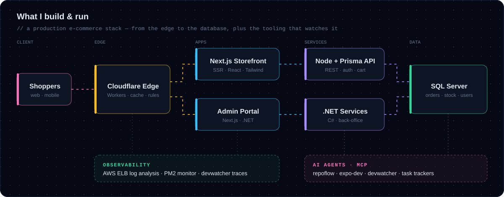
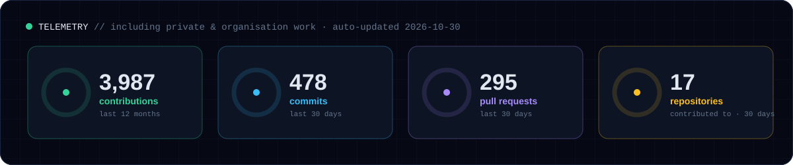

<p align="center">
  
</p>

<h3 align="center">I write it. I plan it. I ship it. I keep it running.</h3>

<p align="center">
  <a href="mailto:virenpatel1293@gmail.com"></a>
  
</p>

<br/>

<p align="center">
  
</p>

<br/>

## ⚡ One engineer, the whole delivery loop

<p align="center">
  
</p>

<table>
  <tr>
    <th width="33%">🟣 Project Manager</th>
    <th width="33%">🔵 Coder</th>
    <th width="33%">🟢 DevOps</th>
  </tr>
  <tr valign="top">
    <td>
      • Turn messy business asks into scoped, shippable tickets<br/>
      • Own the backlog, priorities and the sprint<br/>
      • Run code reviews &amp; approvals across teams<br/>
      • Keep releases predictable — no surprises on launch day
    </td>
    <td>
      • Full-stack: <b>Next.js / React</b>, <b>Node</b>, <b>.NET C#</b><br/>
      • Data with <b>Prisma + SQL Server</b><br/>
      • Mobile with <b>React Native / Expo</b><br/>
      • Python tooling &amp; automation<br/>
      • Small PRs, typed code, fast feedback
    </td>
    <td>
      • CI/CD with <b>GitHub Actions</b><br/>
      • Edge caching &amp; routing on <b>Cloudflare Workers</b><br/>
      • <b>AWS</b> load-balancer log forensics<br/>
      • <b>PM2</b> process monitoring<br/>
      • Performance &amp; security tracing in dev
    </td>
  </tr>
</table>

<br/>

## 🏗️ The system I build & run

<p align="center">
  
</p>

<br/>

## 🛰️ Mission log

<!-- MISSION-LOG:START -->
<table>
  <tr valign="top">
    <td width="50%">
      <h4>☁️ DevOps &amp; Platform</h4>
      <b>DOMDoctor</b> — Chrome DevTools extension: DOM health score &amp; fixes for heavy pages <sub>⚪ 4mo ago</sub><br/>
      <b>Blog optimiser</b> — faster, leaner content pages <sub>⚪ 11mo ago</sub><br/>
      <b>PM2 Monitor</b> — live health &amp; restart tracking for Node services <sub>⚪ 1y ago</sub><br/>
      <b>Cloudflare Worker</b> — edge caching &amp; routing in front of a live storefront <sub>⚪ 1y ago</sub><br/>
      <b>ELB Log Analyzer</b> — finds slow &amp; failing routes in AWS load-balancer logs <sub>⚪ 1y ago</sub>
    </td>
    <td width="50%">
      <h4>🤖 AI Tooling (MCP servers) <sub>· 1 active this week</sub></h4>
      <b>video-analyzer-mcp</b> — lets AI agents “watch” videos — ffmpeg frames, labelled by timestamp <sub>🟢 5d ago 🆕</sub><br/>
      <b>devwatcher-mcp</b> — per-page traffic: loops, payload sizes, timing &amp; security risks <sub>🟡 18d ago 🆕</sub><br/>
      <b>expo-dev-mcp</b> — analyses an Expo app &amp; runs it on a simulator <sub>🟡 19d ago 🆕</sub><br/>
      <b>repoflow-mcp</b> — visualises any repo's structure &amp; flow <sub>🟡 21d ago 🆕</sub><br/>
      <b>github-task-tracker · google-tasks-mcp</b> — agents ↔ the team backlog <sub>🟡 21d ago</sub><br/>
      <b>Session Vault</b> — browse, back up &amp; restore Claude Code chat sessions per project — fully local <sub>⚪ 1mo ago</sub>
    </td>
  </tr>
  <tr valign="top">
    <td width="50%">
      <h4>🛒 Product Engineering <sub>· 1 active this week</sub></h4>
      <b>Storefront &amp; Admin</b> — Next.js + Prisma API + .NET admin for high-traffic e-commerce <sub>🟢 today</sub><br/>
      <b>Party@Janvi</b> — rental-management Android app for a real party-hire business <sub>🟡 19d ago 🆕</sub><br/>
      <b>StockMaster</b> — Python stock &amp; market-data tooling <sub>🟡 19d ago 🆕</sub><br/>
      <b>face3d</b> — desktop app turning fixed-angle photos into a 3D head model <sub>🟡 28d ago 🆕</sub>
    </td>
    <td width="50%">
      <h4>🎮 After Hours — Game Dev <sub>· 1 active this week</sub></h4>
      <b>REVOLUTION</b> — civilisation-building strategy game: cave-dwellers → smart city (Unity · C#) <sub>🟢 yesterday 🆕</sub><br/>
      <b>game-asset-mcp</b> — an AI agent that sources free models &amp; textures for my games <sub>🟡 12d ago 🆕</sub><br/>
      <b>Ashes of Tomorrow</b> — mobile survival game (Godot) <sub>🟡 13d ago 🆕</sub>
    </td>
  </tr>
</table>

<sub>🔒 Most of this lives in private &amp; organisation repos — happy to demo any of it on a call. &nbsp;·&nbsp; 🟢 pushed this week &nbsp;🟡 this month &nbsp;⚪ earlier &nbsp;🆕 new &nbsp;·&nbsp; auto-updated 2026-11-04</sub>
<!-- MISSION-LOG:END -->

<br/><br/>

## 🧰 Toolbox

<p align="center">
  <br/>
  
</p>
<p align="center">
  
  
  
  
  
</p>

<br/>

## 📡 Telemetry

<p align="center">
  
</p>

<p align="center">
  <picture>
    <source media="(prefers-color-scheme: dark)" srcset="https://raw.githubusercontent.com/virenpatel1293/virenpatel1293/output/snake-dark.svg" />
    
  </picture>
</p>

<br/>

## 🔭 Right now

```diff
+ shipping   →  e-commerce features, faster checkout & cleaner caching at the edge
+ building   →  MCP servers that let AI agents debug, trace and run real apps
+ leading    →  sprint planning, PR reviews and release trains across teams
! after dark →  REVOLUTION — a strategy game from cave fire to smart city
```

<br/>

<p align="center">
  <b>💬 Ask me about</b> Next.js performance · CI/CD · edge caching · MCP servers · running a team that ships
</p>

<p align="center">
  <a href="mailto:virenpatel1293@gmail.com"></a>
</p>
